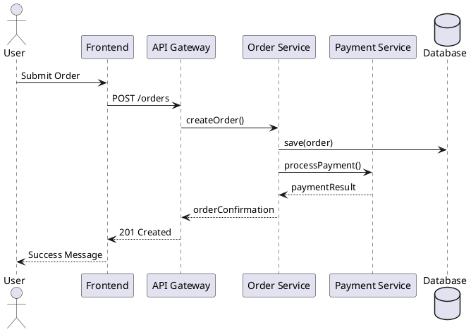
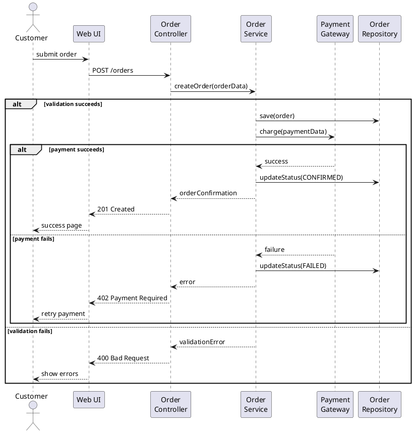

# Runtime view

The CTO selects scenarios that explain consequential behavior rather than routine framework operations. Read the corresponding requirements, components, and relevant implementation first.

For each scenario, identify its trigger, preconditions, participants, exchanged information, and observable outcome. Use a sequence diagram or concise ordered description. Internal participants must correspond to chapter 5; external actors and systems must agree with chapter 3.

Show ordering, concurrency, state changes, and ownership only to the depth needed to explain the design. Include failure and recovery behavior where it affects correctness or user trust: partial completion, retries, duplicate requests, interrupted work, and unavailable dependencies.

Distinguish verified runtime behavior from proposed flows. Do not invent retry guarantees or consistency semantics. Link important choices to decisions and quality scenarios, and validate diagrams against the same component names and boundaries used elsewhere.

Examples and template values below are hypothetical, not Situate requirements or implementation evidence. Use the repository's AsciiDoc structure and approved catalog targets; adapt formats without creating parallel specifications.

## Overview

The Runtime View (Chapter 6) describes the **dynamic behavior** of the system - how building blocks interact at runtime to fulfill specific tasks. Unlike the static Building Block View (Chapter 5), it focuses on behavior, interactions, and temporal sequences.

### Key Difference: Runtime View vs Building Block View

| Aspect        | Building Block View (Chapter 5)      | Runtime View (Chapter 6)             |
| ------------- | ------------------------------------ | ------------------------------------ |
| **Focus**     | Static structure, decomposition      | Dynamic behavior, interactions       |
| **Content**   | Components, interfaces, dependencies | Scenarios, sequences, workflows      |
| **Question**  | "What exists?"                       | "How does it work?"                  |
| **Viewpoint** | Structural/Static                    | Temporal/Dynamic                     |
| **Notation**  | Component diagrams, class diagrams   | Sequence diagrams, activity diagrams |

## Content Checklist

A complete Runtime View should cover scenarios from these areas:

- [ ] **Important Use Cases/Features**: How building blocks execute core functionality
- [ ] **Critical External Interfaces**: Interactions with users and neighboring systems
- [ ] **Operation & Administration**: Launch, startup, shutdown sequences
- [ ] **Error & Exception Scenarios**: Failure handling and recovery

## How Many Scenarios?

Start with a few representative scenarios, often three to seven. Add scenarios when distinct risks or lifecycle boundaries need explanation; there is no fixed maximum.

Runtime scenarios are time-consuming to create and maintain. Focus on:

1. **Architecturally relevant** scenarios (not every use case)
2. **Complex, risky, or interesting** interactions
3. **Critical quality goals** (performance, security, reliability)
4. **Volatile external interfaces**
5. **Hard-won design decisions** that need explanation

> **Important**: Document scenarios primarily to **design and discuss** building blocks, not just for documentation. Keep only the essential ones.

## Scenario Selection Criteria

Document scenarios that are:

| Criterion                      | Example                                      |
| ------------------------------ | -------------------------------------------- |
| **Critical for understanding** | Core business processes                      |
| **Quality-critical**           | Real-time processing, security checks        |
| **Risky**                      | Complex algorithms, new technologies         |
| **External interfaces**        | Critical or unstable third-party APIs        |
| **Design-challenging**         | Required significant architectural decisions |

**Do NOT document:**

- Simple CRUD operations
- Standard framework behavior
- Trivial data flow without interesting interactions
- Everything "just to be complete"

## Notation Options

### 1. Sequence Diagrams (Recommended)

**Best for**: Detailed interactions between building blocks

**Advantages**:

- Clear responsibility assignment
- Shows temporal sequence
- Direct mapping to Building Block View

**Tools**:

- **PlantUML** (recommended): Text-based, version-control friendly
- Mermaid: Markdown-integrated
- Draw.io: Visual editing
- Enterprise Architect: Full UML modeling

**PlantUML Example**:



### 2. Activity Diagrams with Swimlanes

**Best for**: Complex workflows with parallel activities

**Advantages**:

- Shows decision points and branches
- Swimlanes assign activities to building blocks
- Good for high-level process flows

### 3. Flowcharts

**Best for**: Simple decision logic

## Best Practices for Sequence Diagrams

### DO:

1. **Map to existing building blocks**
   - Internal lifelines correspond to Chapter 5; external actors and systems correspond to Chapter 3
   - Use consistent naming

2. **Focus on partial scenarios**
   - Start in the middle of complex processes
   - Cut out boring, standard parts
   - Highlight interesting/risky interactions

3. **Use appropriate abstraction level**
   - High-level: Component interactions
   - Medium: Service calls
   - Low-level: Only if stakeholders need implementation details

4. **Include activation bars**
   - Show when components are active/processing
   - Clarifies concurrent operations

5. **Add explanatory notes**
   - Preconditions, postconditions
   - Business rules being enforced
   - Alternative paths briefly mentioned

6. **Group related messages**
   - Use `alt/opt/loop/par` fragments for:
     - Alternative paths (`alt/else`)
     - Optional steps (`opt`)
     - Loops (`loop`)
     - Parallel execution (`par`)

### DON'T (Anti-Patterns):

1. **The "Everything Diagram"**
   - ❌ One diagram showing the entire system flow
   - ✅ Multiple focused diagrams for specific scenarios

2. **The "Message Flood"**
   - ❌ Dozens of messages without grouping
   - ✅ Group related messages, use references (`ref`)

3. **The "Wrong Abstraction"**
   - ❌ Method-level detail when component-level suffices
   - ❌ Component-level when algorithm detail is needed
   - ✅ Match abstraction to stakeholder needs

4. **The "Orphaned Scenario"**
   - ❌ Scenarios not traceable to building blocks
   - ✅ Internal participants map to Chapter 5 and external participants to Chapter 3

5. **The "Forever Diagram"**
   - ❌ Diagrams spanning multiple pages
   - ✅ Split into logical parts, use `ref` frames

6. **The "Over-Detailed"**
   - ❌ Every getter/setter shown
   - ❌ Framework internals depicted
   - ✅ Focus on architecturally significant interactions

## Structure Template

```markdown
## 6. Runtime View

### 6.1 [Scenario Name]

**Scope**: [What use case/feature this covers]

**Trigger**: [What starts this scenario]

**Participants**: [Internal building blocks from Chapter 5 and external actors/systems from Chapter 3]

**Sequence**:
[PlantUML or description]

**Key Interactions**:

1. [Step description]
2. [Step description]
   ...

**Error Handling**:

- [What happens when things go wrong]

### 6.2 [Next Scenario]

...
```

## Example: Well-Structured Runtime View

````markdown
## 6. Runtime View

### 6.1 Order Processing

**Scope**: Core order creation and payment flow

**Trigger**: Customer submits order via web interface

**Participants**: Web UI, Order Controller, Order Service, Payment Gateway, Order Repository

**Sequence**:



**Key Design Decisions**:

- Synchronous payment processing for immediate feedback
- Order saved before payment to maintain audit trail
- A retryable charge needs a stable idempotency key and a provider contract that deduplicates it. The diagram omits this mechanism; document it before claiming duplicate-charge prevention.
- A timeout may leave payment outcome unknown. Distinguish that case from a definite rejection; reconcile uncertain charges before retrying.

### 6.2 System Startup

**Scope**: Application initialization sequence

**Trigger**: Container orchestrator starts service

**Participants**: [Listed...]

[...]
````

## Common Pitfalls

### 1. Documentation for Documentation's Sake

**Problem**: Creating scenarios because "arc42 requires Chapter 6"

**Solution**: Only document scenarios that help stakeholders understand or that helped you design

### 2. Static-Dynamic Mismatch

**Problem**: Runtime scenarios don't match building blocks in Chapter 5

**Solution**: Verify internal participants against Chapter 5 and external actors and systems against Chapter 3

### 3. Over-Specification

**Problem**: Documenting implementation details that change frequently

**Solution**: Stay at architectural level; implementation details belong in code comments

### 4. Under-Specification

**Problem**: Scenarios too vague to be useful

**Solution**: Include concrete message names, data flow direction, and key decisions

### 5. Ignoring Error Cases

**Problem**: Only documenting "happy path"

**Solution**: Include at least one error scenario for critical flows

## Review Checklist

Before finalizing your Runtime View:

- [ ] Internal participants map to Chapter 5 and external actors/systems to Chapter 3
- [ ] Scenario names are descriptive (not just "Scenario 1")
- [ ] At least one error/exception scenario included
- [ ] Abstraction level matches stakeholder needs
- [ ] PlantUML/textual diagrams are version-controlled
- [ ] Scenarios are numbered consistently
- [ ] Complex scenarios are split into logical parts
- [ ] Each scenario has a clear scope description

## Quick Reference

| When to Use            | Notation                     | Example             |
| ---------------------- | ---------------------------- | ------------------- |
| Component interactions | Sequence diagram             | Service calls       |
| Complex workflows      | Activity diagram + swimlanes | Multi-step process  |
| Simple decision logic  | Flowchart                    | Authorization check |
| High-level overview    | BPMN                         | Business process    |

## Further Reading

- arc42 Documentation: https://docs.arc42.org/section-6/
- PlantUML Sequence Diagrams: https://plantuml.com/sequence-diagram
- arc42 Tips by Keyword: https://docs.arc42.org/keywords/
