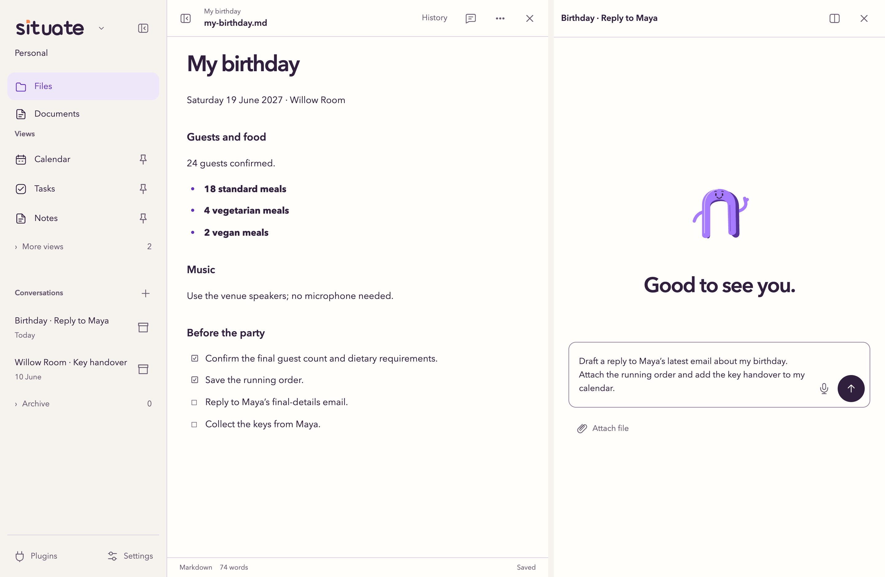

<h1 align="center">
  <picture>
    <source media="(prefers-color-scheme: dark)" srcset="design/brand/assets/wordmark-light.svg">
    
  </picture>
</h1>

<p align="center">An open-source macOS app for organizing your notes and tasks with AI.</p>

<p align="center">Work with your own context, carry out organizational tasks, and build tools for the way you work.</p>

<p align="center">
  <a href="https://getsituate.com/#download">Download for macOS</a> ·
  <a href="#documentation">Documentation</a> ·
  <a href="#contributing">Contributing</a>
</p>



## What you can do

### Work with your notes

Develop ideas in conversation, find information in your workspace, and revise or combine notes. Save the result as text you can keep using, with file history available to review earlier changes.

### Move tasks forward

Capture commitments, update task files, and work through priorities using relevant notes and context. Situate supports your working method rather than requiring a particular organizational system.

### Create your own tools

Describe a tool or workflow you need and ask Situate to develop a plugin. Plugins can add callable tools, custom views, working-method guidance and connections to external services. Their capabilities depend on the service interfaces, permissions and local tools available.

The [Product Capability Catalog](docs/product-capability-catalog/README.md) records support, prerequisites, evidence and known gaps for individual workflows. Email and calendar workflows require separately configured, authenticated plugins; Situate does not bundle native email or calendar connectors.

## Status and direction

Situate is available on **macOS**. Windows is the next platform in development and is not yet available. iOS, Linux desktop and Android remain deferred.

Notes and tasks live in local workspace files. AI features require configured access to a supported model provider; provider charges may apply, and workspace content used for AI requests can be sent to that provider. See [AI access and supported authentication](client/README.md#workspace-ai-access-and-chat).

Plugins are trusted code, not sandboxed extensions. They can access files, run local programs and perform external actions without per-action confirmation. Review generated code and results, and only enable plugins you trust.

Document management is not yet supported. The [product direction](docs/product-concept.md) also describes planned optional synchronization and managed AI services; these are not currently available offerings.

## Build from source

Development requires macOS, Git, Python 3, [Volta](https://volta.sh/), Rust through rustup, and Xcode with its Command Line Tools. Volta selects the repository-pinned Node.js and npm versions; the client pins its Rust toolchain. Follow the [setup guide](docs/development/README.md) and [native prerequisites](client/README.md#prerequisites) before running:

```sh
git clone https://github.com/getsituate/situate.git
cd situate
node tools/npm-ci.mjs
node tools/npm-ci.mjs client
cd client
npm run dev:client
```

This starts the local development app. Pi, Herdr, an AI subscription and model credentials are not required to build or test it. Model access is needed to use AI features.

## Contributing

Bug reports, usability feedback, documentation fixes and code contributions are welcome. [Open an issue](https://github.com/getsituate/situate/issues) with the app and macOS versions, steps to reproduce the problem, and what you expected to happen. Use synthetic examples and remove personal content, credentials and private paths from screenshots and logs.

For code changes, start with the [developer setup](docs/development/README.md), follow the [repository guidelines](AGENTS.md), and run focused checks for the behavior you change. The [test guide](docs/development/testing.md) explains test selection and prerequisites; CI runs the broader PR verification plan. Discuss substantial feature or architecture changes in an issue before implementation.

Report vulnerabilities confidentially through the [security policy](SECURITY.md), not in public issues.

## Documentation

- [Product capabilities](docs/product-capability-catalog/README.md) — workflows, prerequisites and current limits.
- [Product direction](docs/product-concept.md) — intended scope and business model.
- [Development and testing](docs/development/README.md) — setup, app commands and optional agent tooling.
- [Architecture](docs/architecture/README.md) — system structure and technical decisions.
- [Goals and requirements](requirements/README.md) — product decisions, acceptance criteria and catalog viewer.
- [Brand handbook](design/brand/README.md) — visual identity, Bend artwork and voice.

## License

Original software and documentation use the [MIT License](LICENSE). Original illustrations, Bend, wordmarks and app-icon artwork by Situate contributors use [CC BY 4.0](LICENSES/CC-BY-4.0.txt). Third-party material retains its own licenses and notices.

See [Licensing and reuse](LICENSING.md) for scope and attribution requirements, and the [trademark policy](TRADEMARKS.md) for use of Situate's name and identity. The copyright licenses do not grant permission to impersonate the project or its official services.
