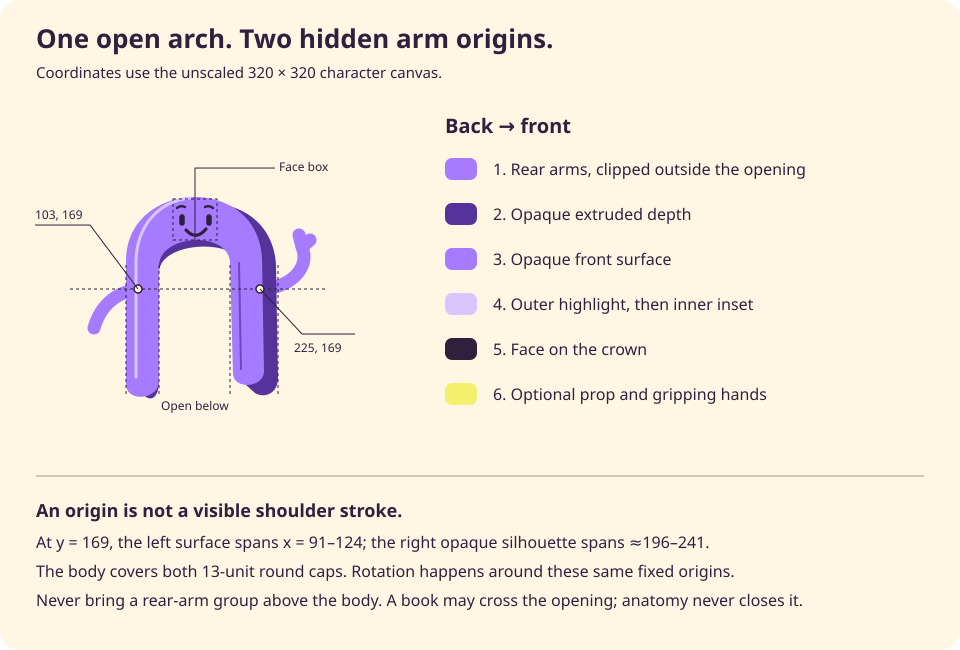

# Bend character manual

Bend is Situate's open, dimensional violet arch: a face on the crown, two long sides, and an empty opening below. It offers company without asking to be looked after. Its world is warm paper, colorful books, personal interests and quiet work—not a control room or a corporate assistant.

- [Character preview](index.html): all poses and expressions, size samples and finite motion controls.
- [Brand reference](../reference/index.html): Bend in the wider Situate identity.
- [Master SVG](svg/bend-master.svg): welcome expression, waving pose, 320 × 320 canvas.
- [Construction diagram](anatomy.svg): dimensions, arm origins and paint order.
- [Mini Bend](mini/README.md): a separate 16–32 px mark and ASCII loading frames; [live reference](../reference/index.html#mini-bend).
- [Canonical source](bend.js), [motion controller](motion.js), [export generator](generate.cjs).
- [Articulated performance rig](PERFORMANCE.md): mouth movement, blinks, wink, arms and steps; [introduction and gesture study](../examples/first-hello/index.html).

This is a visual asset library, not a product implementation. Books and cards in the examples are synthetic illustrations. The local preview does not run AI, save tasks, connect services or demonstrate approval enforcement. Product scope and unresolved commitments remain in the [product concept](../../../docs/product-concept.md), [positioning](../../../docs/positioning.md) and [foundations](../../../requirements/data/foundations.md).

## Character decisions

These rules describe the full illustrated character. [Mini Bend](mini/README.md) is a separate optical symbol with an open arch and two eyes in the opening, without arms or depth. Its compact construction is not a replacement for the crown face or layered body at illustration sizes.

Keep these features together:

1. **Inverted U, open below.** Never add a belt, bridge, crossbar, lower connector or flat baseline joining the sides. A removable book may sit in front of the opening; it is not anatomy.
2. **Face on the crown.** The opening is negative space, not a head or a mouth. Do not put the eyes inside it.
3. **Violet volume.** The lighter front, dark offset depth, fine outside highlight and inside crease work as a set. Do not replace them with a flat logo treatment, thick black outline, gradient or glossy plastic shading.
4. **Arms emerge outside the silhouette.** Their origins remain behind the opaque body, not drawn across its front. Hands and props can intentionally overlap the body.
5. **Adult warmth.** Small facial differences, soft curves and restrained gestures. No tears over unfinished tasks, begging, hearts demanding attention, streak anxiety or disappointed reactions to absence.
6. **Still is the normal state.** A welcome can be expressive; daily work should remain legible and quiet. A completed action does not automatically need a celebration.

The underlying body and five faces retain the refined Bend construction. Poses are independent of expression; switching mood does not stretch the arch or move the face into the opening.

## Files and reproducibility

| File                          | Role                                                                                  |
| ----------------------------- | ------------------------------------------------------------------------------------- |
| `bend.js`                     | Single canonical, dependency-free geometry source; browser global and CommonJS export |
| `motion.js`                   | Finite Web Animations controller for the inline SVG                                   |
| `generate.cjs`                | Deterministic SVG and construction-diagram generation                                 |
| `svg/<pose>-<expression>.svg` | Thirty standalone, informative SVGs                                                   |
| `svg/bend-master.svg`         | Canonical welcome wave                                                                |
| `anatomy.svg`                 | Generated construction diagram; no external symbol references                         |
| `index.html`, `example.js`    | Local interactive character library; system fonts only                                |
| `bend.test.cjs`               | Built-in Node tests, including export drift                                           |
| `browser.test.cjs`            | Optional browser checks using an existing Playwright installation                     |

Open `index.html` directly from disk. No server, install, font download or build step is needed for the preview. The static SVGs also work as ordinary images without JavaScript. Inline the SVG only when independent arm/face motion is needed.

From the repository root:

```sh
node design/brand/bend/generate.cjs
node design/brand/bend/generate.cjs --check
node --test design/brand/bend/bend.test.cjs
```

Generation uses Node's built-in modules only. It writes exactly 30 combinations and the master into `svg/`, plus `anatomy.svg`. There are no timestamps, random IDs or environment-specific paths. `--check` writes nothing and exits nonzero for missing, changed or unexpected `.svg` exports, or a changed diagram. Unexpected SVGs are reported, not deleted. Other filenames in `svg/` are ignored. Do not hand-edit generated assets; change `bend.js` or the diagram template in `generate.cjs`, then regenerate.

## Canvas, dimensions and space

All geometry uses a `viewBox="0 0 320 320"`. The origin is the upper-left corner; x increases rightward, y downward. Numeric lengths below are SVG units, not CSS pixels.

| Feature                                     | Geometry                                        |
| ------------------------------------------- | ----------------------------------------------- |
| Body bounding box, excluding strokes        | x = 91–243, y ≈ 76.964–278.455                  |
| Front left outside vertical                 | x = 91, y = 141–264                             |
| Front left opening edge                     | x = 124, y = 146–261                            |
| Front right opening edge                    | (195, 143) → (198, 254)                         |
| Front right outside edge                    | (227, 139) → (229, 251)                         |
| Dark right outside edge                     | (241, 145) → (243, 258)                         |
| Clear central opening                       | x = 124–195, y = 155–260, absent optional props |
| Face safety box, including strokes          | x = 138–182, y = 79–120                         |
| Left arm origin                             | (103, 169)                                      |
| Right arm origin                            | (225, 169)                                      |
| Whole-figure animation pivot                | (160, 270)                                      |
| Face animation pivot                        | (160, 100)                                      |
| Static art safety bounds, including strokes | x = 38–300, y = 68–279, across the six poses    |

Preserve the whole 320-unit canvas when interchanging assets: all poses then share the same crown, feet and animation origin. Do not crop to each pose's visible bounding box, because a pose swap would change apparent scale. Motion needs the remaining canvas margin. Give the canvas at least another 16 CSS pixels of clearance from adjacent controls or text when used at 160 CSS pixels or larger. In compositions, the figure may sit in a larger scene; do not crop off its feet or hands.

### Size limits

- **64 CSS pixels:** minimum full-character use. The silhouette reads; the face is a texture, not a reliable mood signal. Prefer `rest`/`welcome` without a prop. Do not shrink this drawing into a 16–32 px toolbar or status icon; use the separate [Mini Bend](mini/README.md) source where a small brand mark is appropriate.
- **96–159 CSS pixels:** a secondary illustration. Crown features begin to read; expression differences still need accompanying words.
- **160–320 CSS pixels:** preferred range for an expressive character, preview, welcome or quiet vignette. Books become legible as objects rather than colored bars.
- **Above 320 CSS pixels:** SVG scales cleanly. Keep the same stroke-to-body proportions; do not use non-scaling strokes. Large decorative art belongs outside dense daily-work surfaces.

Never let the character carry essential status, progress, errors or instructions by expression alone. A small-size sample is not evidence that all expressions are distinguishable there.

## Exact construction



### Body paths

These paths are canonical. `geometry` exports the same strings; no second hand-maintained drawing exists in the exports.

**Depth**, opaque `#56329b`:

```svg
<path d="M105 270V148c0-82 131-89 136-3l2 113c0 15-13 21-23 15l-9-8-2-115c-1-33-84-30-85 2v110c0 15-9 24-19 8Z"/>
```

**Front**, opaque `#a77bff`:

```svg
<path d="M91 264V141c0-82 132-88 136-2l2 112c0 17-30 19-31 3l-3-111c-1-33-71-29-71 3v115c0 19-33 22-33 3Z"/>
```

**Outside highlight**, no fill, `#d9c6ff`, width 3, round cap:

```svg
<path d="M101 257V142c0-35 22-61 54-64"/>
```

**Inside crease**, no fill, `#7045bd`, width 2, round cap:

```svg
<path d="M204 143l2 106"/>
```

The crown's front outer cubic begins at (91, 141), with controls (91, 59), (223, 53), ending at (227, 139). Its opening cubic is traversed from (195, 143), with controls (194, 110), (124, 114), ending at (124, 146). These unequal outer and inner curves make a substantial crown for the face. The depth is a separate silhouette, not a generic drop shadow or a translated copy of the front. Keep both paths intact.

### Paint order and arm anatomy

Back to front:

```text
svg
├─ defs: two exterior arm clips
└─ figure                         pivot 160,270; whole-figure motion
   ├─ rear-arms
   │  ├─ left exterior clip       fixed in figure coordinates
   │  │  └─ left-arm              pivot 103,169
   │  └─ right exterior clip      fixed in figure coordinates
   │     └─ right-arm             pivot 225,169
   ├─ body                        opaque; never animate opacity
   │  ├─ depth
   │  ├─ front
   │  ├─ highlight
   │  └─ inset
   ├─ face                        pivot 160,100
   └─ prop
      └─ optional artwork + hands
```

Both arms use `#a77bff`, no fill, width 13, round caps and joins. Their first points are always (103,169) and (225,169), even when the hands move. The 6.5-unit radius root cap is wholly inside the union of the opaque front and depth shapes. At y = 169 the left front spans x = 91–124; the right opaque body spans approximately x = 196–241. Do not anchor a waving arm to the visible crease at x ≈ 204 or to the exterior highlight at x = 101 and then paint it on top.

Layering—not hand placement—is what prevents collisions. The body is painted after both arm groups, covering the roots and the part of each limb that passes under the body. The highlight and crease are painted later still. Rotating the arm group around its fixed origin therefore cannot drag its root stroke over these contours.

There is an additional guard against an arm crossing the open center: the left arm's fixed exterior clip covers x = 0–124, y = 0–320; the right covers x = 195–320, y = 0–320. The clips wrap the animated groups rather than rotating with them. Clips are not substitutes for the opaque body layer. They must remain within the same whole-figure transform as the body.

Exact centerline paths:

| Pose        | Left arm `d`                     | Right arm `d`                                         |
| ----------- | -------------------------------- | ----------------------------------------------------- |
| `rest`      | `M103 169C79 173 65 187 59 208`  | `M225 169C249 176 259 191 262 212`                    |
| `wave`      | `M103 169C79 173 65 187 59 208`  | `M225 169C253 169 276 149 267 127m0 0-3-12m3 12 8-7`  |
| `read`      | `M103 169C63 179 72 210 118 216` | `M225 169C269 183 268 207 215 214`                    |
| `carry`     | `M103 169C57 188 66 218 108 235` | `M225 169C279 187 272 219 230 233`                    |
| `celebrate` | `M103 169C70 170 55 154 45 124`  | `M225 169C249 173 264 150 270 125`                    |
| `point`     | `M103 169C79 173 65 187 59 208`  | `M225 169C251 172 261 149 278 148m0 0 15-1m-15 1 5 9` |

For new arms, sample the full root-cap circumference against the opaque body, not just the centerpoint. The browser test checks samples every 15° at radius 6.5. Check rendered contours with the arm at rest and both extremes of its rotation. A transparent body or an arm group reordered above `body` invalidates these checks.

### Expressions and exact face geometry

Static face strokes use `#30203e`, no fill, round caps and joins. The optional [performance rig](PERFORMANCE.md) can briefly fill its small open-mouth contour with the same plum color; static exports are unchanged. Do not add white eyeballs, nose, cheeks or a second face in the opening. The feature coordinates stay in the crown box across all poses. Poses do not move the face independently of the body; `consider` shifts the complete face by just −1 unit horizontally.

| Expression | Brows (`d`, width 2.4)           | Eyes                                                                 | Mouth                                                |
| ---------- | -------------------------------- | -------------------------------------------------------------------- | ---------------------------------------------------- |
| `welcome`  | `M142 88q4-3 8-1m20 0q4-2 8 1`   | `M147 97v6m27-6v6`, width 5.5                                        | `M151 110q10 11 20-1`, width 3.2                     |
| `curious`  | `m144 90 8-2m15-4q5-4 10-1`      | `M149 98v4m24-8v8`, width 5.5                                        | Ellipse center (164,112), radii (3.5,4.5), width 2.6 |
| `thinking` | `M141 88q5-3 10-1m15 0q5-2 10 1` | Lids `M144 97h9m16 0h9`, width 3; pupils `M146 98v4m25-4v4`, width 4 | `M155 111h10`, width 3                               |
| `pleased`  | `M142 88q4-3 8 0m20 0q4-3 8 0`   | `M142 101q5-9 10 0m17 0q5-9 10 0`, width 3.3                         | `M151 109q10 14 21 0q-10 5-21 0Z`, width 2.5         |
| `unsure`   | `M142 88q4-4 9-2m19 5h9`         | `M148 97v6m27-3v4`, width 5                                          | `M151 113q4-3 9 0t10 0`, width 2.7                   |

Differences are meaningful, not five intensities of happiness:

- **Welcome:** relaxed brows and an open smile. Arrival, an introduction, or a user-requested greeting. Not a recurring demand to return.
- **Curious:** one raised brow, uneven attentive eyes, a small round mouth. Exploring an interest or offering an optional next question. Not shock at the user's choices.
- **Thinking:** sideways pupils under level lids and a short level mouth. Considering related material. Not proof of reasoning quality, a fake progress meter or an invitation to wait indefinitely.
- **Pleased:** crescent eyes and a broad smile. Quiet acknowledgment or an occasional personally meaningful completion. No reward loop for routine clicks.
- **Unsure:** uneven brows and a small wavy mouth. Ambiguity that needs the user's input. Pair with a clear question and available choices, never blame or alarm. Serious failures deserve direct, calm language rather than comic distress.

### Props and hands

Props are deliberately separate from body anatomy. `read` holds an open cream book; `carry` holds three colored books; `celebrate` holds a small yellow checked card. `rest`, `wave` and `point` have an empty `prop` group. None of these objects is a claim that an actual file exists or an action has succeeded.

| Prop         | Exact placement and construction                                                                                                                                                                                                                    |
| ------------ | --------------------------------------------------------------------------------------------------------------------------------------------------------------------------------------------------------------------------------------------------- |
| Open book    | Local group translated (0,12). Dark cover path `m120 164 44 10 46-16 5 67-48 17-44-12Z`; cream pages `m125 160 39 9 40-15 5 65-42 16-39-11Z`. Spine and five short page lines use `#ad9284`, width 2. Orange bookmark `m145 225 8 2 1 26-6-6-5 3Z`. |
| Book hands   | Same (0,12) group; `m111 199 13 5m86-4 10-9`, width 13. These are short gripping marks, not shoulder origins.                                                                                                                                       |
| Stack        | Local group translated (0,18). Lemon rectangle (93,187), 142×23, radius 5; sky rectangle (104,167), 125×21, radius 4; orange rectangle (107,207), 132×24, radius 4. Two white page lines `M110 173h110m-98 8h98`, width 2.                          |
| Stack hands  | Same (0,18) group; `m112 214 16 1m90 1 13-2`, width 12.                                                                                                                                                                                             |
| Checked card | Group rotated 12° about (265,104). Dark-gold rectangle (243,78), 45×51, radius 8; lemon front (239,73), 45×51, radius 8; ink check `m250 97 7 7 14-17`, width 3.5, round caps/joins.                                                                |

The book and stack are painted in front of the body; their hands are painted last inside the same prop transform. Move the complete figure to animate these poses. Moving only a book or rotating a gripping arm without also solving its hand contact would detach it. A new foreground hand may overlap a highlight where it actually grips an object; a shoulder stroke may not.

## Color source

`SituateBend.colors` exports these exact hex values. The body colors are not aliases of the brand accent violet; replacing the front with `violet` changes the character. All body fills are opaque. The SVG has no background, gradients, filters, external fonts or raster texture.

| Export      | Hex       | Role                                          |
| ----------- | --------- | --------------------------------------------- |
| `body`      | `#a77bff` | Front, limbs and hands                        |
| `depth`     | `#56329b` | Body extrusion                                |
| `highlight` | `#d9c6ff` | Outside rim light                             |
| `inset`     | `#7045bd` | Fine inside crease                            |
| `ink`       | `#30203e` | Face, book cover and card mark                |
| `cream`     | `#fff7e3` | Book pages and warm illustration paper        |
| `white`     | `#fffefa` | Page highlights and light surface             |
| `orange`    | `#ff874d` | Bookmark and lower book                       |
| `lemon`     | `#f4f06d` | Book and card                                 |
| `sky`       | `#48b7ff` | Upper book                                    |
| `pageLine`  | `#ad9284` | Book-page linework                            |
| `cardDepth` | `#d7ad38` | Card extrusion                                |
| `paper`     | `#f6f3ee` | Original surrounding paper token              |
| `muted`     | `#6a5c70` | Surrounding secondary text token              |
| `violet`    | `#8651ed` | Surrounding accent violet                     |
| `deep`      | `#6232bc` | Surrounding deep-violet token, not body depth |
| `cobalt`    | `#305cf4` | Surrounding blue accent                       |
| `peach`     | `#ffc3a3` | Surrounding warm accent                       |
| `line`      | `#d9d0df` | Surrounding line token                        |

Prefer cream, paper, white or pale color fields behind the character. A dark ink field can support the unchanged artwork with adequate breathing room; it is not a separate character theme or a promise of a product dark mode. Do not recolor Bend to encode success, failure, identity or urgency. Color is never the sole source of meaning.

## Rendering API

Load `bend.js` as a classic script. It exposes `window.SituateBend`; `require('./bend.js')` exposes the same object in Node. There are no imports or runtime dependencies.

```html
<div id="welcome-art"></div>
<script src="bend.js"></script>
<script>
  document.querySelector("#welcome-art").innerHTML = SituateBend.render({
    idPrefix: "welcome-bend",
    pose: "wave",
    expression: "welcome",
    title: "Bend waves hello",
    decorative: false,
  });
</script>
```

`SituateBend.render({idPrefix, pose = 'wave', expression = 'welcome', title = 'Bend', decorative = false})` returns a complete SVG string, including its SVG namespace, 320-unit viewBox, explicit 320×320 dimensions, local clip definitions and artwork. Resize with CSS `width` and `height: auto`, or change the outer SVG width/height while preserving the viewBox.

- **`idPrefix` is required.** Start with an ASCII letter; thereafter use only ASCII letters, digits, `_` or `-`. Use a unique prefix per simultaneously embedded SVG. Clip IDs and the accessible title ID are prefixed. The renderer is deliberately deterministic, not an ID allocator. Repeating the same standalone image in separate `` elements is safe because their SVG documents are separate.
- **Names are exact and case-sensitive.** Poses: `rest`, `wave`, `read`, `carry`, `celebrate`, `point`. Expressions: `welcome`, `curious`, `thinking`, `pleased`, `unsure`. Unknown names, including inherited object-property names, throw `RangeError`; there is no silent fallback.
- **Informative art:** `decorative: false` adds `role="img"`, `aria-labelledby` and an escaped `<title>`. Supply a short contextual title. Empty or whitespace-only informative titles throw `TypeError`.
- **Decorative art:** `decorative: true` adds `aria-hidden="true"` and omits the title and image role. Use this when nearby text already communicates the meaning. `focusable="false"` is present in both cases. The caller is responsible for an enclosing image's `alt` when using ``.
- **Input safety:** titles must be XML-compatible strings; `&`, `<`, `>`, single and double quotes are escaped. Invalid XML controls and unpaired surrogates are rejected. `idPrefix` is validated and escaped; pose/expression values are allowlisted and escaped. Nonboolean `decorative` throws. No input becomes raw SVG markup.
- **Metadata:** `colors`, `geometry`, `expressions`, `poses`, `expressionNames`, `poseNames` and `armOrigins` are exported, frozen read-only source data. `expressions` contains trusted canonical SVG snippets; do not replace them with user-generated markup. Extend the source rather than mutating these objects at runtime.

Node example:

```js
const fs = require("node:fs");
const Bend = require("./bend.js");
fs.writeFileSync(
  "reading.svg",
  Bend.render({
    idPrefix: "reading-bend",
    pose: "read",
    expression: "thinking",
    title: "Bend reads an open book",
  }),
);
```

### DOM hooks

All hooks use `data-bend-part`. `figure`, `rear-arms`, `left-arm`, `right-arm`, `body`, `depth`, `front`, `highlight`, `inset`, `face` and `prop` occur once each per SVG. `hands` occurs once in `read` and `carry` and is absent elsewhere. Empty `prop` groups remain present to keep selection predictable. Arm groups also carry `data-bend-origin="103 169"` or `"225 169"`. The root carries `data-bend-pose` and `data-bend-expression`.

Use hooks rather than order-based CSS selectors. Their parent hierarchy is part of the anatomy: do not move a hook into a different paint layer. Inline styles on the moving groups set `transform-box: view-box` and explicit pivots in the original coordinate system. Never replace these with `fill-box`/`center`: the center of an arm's bounding box is not its shoulder, and cropped or nested artwork can otherwise pivot unpredictably.

## Motion API and timing

Load `motion.js` after `bend.js`. It exposes `window.SituateBendMotion`. The SVG must be inline and attached to the document for visible playback. `` is intentionally static.

```html
<button id="say-hello">Say hello</button>
<script src="motion.js"></script>
<script>
  const svg = document.querySelector("#welcome-art svg");
  const animation = SituateBendMotion.create(svg);
  document.querySelector("#say-hello").addEventListener("click", () => {
    animation.play("hello");
  });
  // Call animation.destroy() before removing or replacing this illustration.
</script>
```

`create(svgElement)` returns `{play(name), pause(), resume(), stop(), destroy()}`. It rejects non-SVGs or SVGs without a figure hook. Creating a second controller for the same SVG destroys the first. One controller owns only its own animations; it does not cancel unrelated animations in the document.

| Name        | Duration | Figure offsets at 0 / 25% / 65% / 100%                        | Additional movement                                                   | Best pairing                  |
| ----------- | -------- | ------------------------------------------------------------- | --------------------------------------------------------------------- | ----------------------------- |
| `hello`     | 1400 ms  | identity / y −3, rotation −2° / y −2, rotation +1° / identity | Wave pose only: right arm 0°, −18°, +12°, −12°, 0° at 0/25/50/75/100% | `wave` + `welcome`            |
| `consider`  | 1600 ms  | identity / y +2, rotation +2° / same / identity               | Face x 0, −1, −1, 0 at matching offsets                               | `rest` or `read` + `thinking` |
| `gather`    | 1300 ms  | identity / y +3, rotation −3° / y −3, rotation +1° / identity | Props and hands move with the figure, never independently             | `carry` + `welcome`           |
| `celebrate` | 1100 ms  | identity / y +3, rotation −2° / y −8, rotation +2° / identity | No detached card or hand movement                                     | `celebrate` + `pleased`       |
| `point`     | 1000 ms  | identity / x +2, rotation +2° / same / identity               | Point pose only: right arm 0°, −5°, −5°, 0°                           | `point` + `curious`           |

Every gesture is available on every pose. The whole-figure gesture always runs; additional articulated waving or pointing only runs on its matching pose. `hello` on a reading pose is a small greeting sway, not a waving hand through the book. `point` does not turn a resting pose into a pointing pose. Select the matching pose first when that literal gesture is needed. Motions do not mutate expressions or swap poses.

All tracks use `cubic-bezier(.22,.7,.25,1)`, one iteration and `fill: none`. Times are animation timeline values; easing affects the visual position between keyframes. No autonomous idle, looping breathing, repeated blinking or timer-triggered replay is included. Changing a selector in the preview is static until Play is pressed.

### Lifecycle and return values

- `play(name)` validates the name, replaces any existing sequence and returns a Promise resolving to `{name, status}`. Unknown names throw `RangeError` without cancelling the current sequence. Playing after destruction throws `Error`.
- Status is `finished`, `replaced`, `stopped`, `destroyed`, `reduced-motion` or `unsupported`. Cancellation resolves; it does not reject. Missing Web Animations support or an animation-construction failure resolves `unsupported` and leaves the base art still.
- `pause()` persists until explicit `resume()`, including across `play()` and `stop()`. A new gesture while paused is created at its starting state and waits. The preference belongs to this controller, not globally to all SVGs.
- `resume()` clears the explicit pause. It does not override reduced motion, a hidden document or offscreen suspension, and does not start a new sequence after a stop or completion.
- Live `prefers-reduced-motion: reduce` cancels the sequence, restores the static art and resolves `reduced-motion`. A play call while reduced motion is set resolves immediately without animation. Turning reduced motion off does not replay skipped motion.
- A hidden document or offscreen SVG suspends time rather than completing the gesture. Visibility is checked initially, through IntersectionObserver when available, and on scroll/resize. Without IntersectionObserver, initial/scroll/resize checks still work. Returning to view resumes only if not explicitly paused. Hidden elements with zero layout dimensions also suspend. CSS occlusion behind another element is not detected.
- `stop()` cancels owned tracks, removes listeners/observers and restores static artwork. It is safe to call repeatedly. A later `play()` reconnects visibility and preference listeners.
- Completion also releases listeners/observers and cancels the finished animation objects. `destroy()` additionally makes the controller unusable; it is idempotent. Other non-play methods after destruction are harmless. `pause`, `resume`, `stop` and `destroy` return `undefined`.

The controller only reacts to visibility changes delivered while a sequence exists. If an element is removed or hidden by a host framework, call `stop()` or `destroy()` as part of that host lifecycle rather than relying on a final observer notification. App-level sheets or modal dialogs can explicitly call `pause()`; dismissal can call `resume()` only when the user's pause choice permits it.

**Never await animation to commit a product change.** Motion is decoration and can be skipped, replaced, paused indefinitely or unsupported. Update actual application state and accessible feedback independently; then optionally play a gesture. Do not interpret `finished` as proof that a file was created, a message sent, or an external operation succeeded.

## Situation guide

| Situation                                            | Choice                                            | Keep out                                                 |
| ---------------------------------------------------- | ------------------------------------------------- | -------------------------------------------------------- |
| First welcome or optional greeting                   | `wave` + `welcome`; one `hello`                   | Repeating waves while a person reads                     |
| Daily lists, notes and documents                     | No character, or a small still `rest` + `welcome` | A mascot next to every row or empty field                |
| Revisiting reading or personal material              | `read` + `thinking`; usually still                | A pretend live reading/progress indicator                |
| Bringing related items into a vignette               | `carry` + `welcome`; one `gather`                 | Claims that illustration movement proves data transfer   |
| A meaningful completion chosen for acknowledgment    | `celebrate` + `pleased`; one short rise           | Celebrating every checkbox, confetti over work, streaks  |
| Optional suggestion or a nearby feature introduction | `point` + `curious`; restrained `point`           | Pointing at a destructive action or a pressured purchase |
| A question with insufficient information             | `rest` + `unsure`; still, with a direct question  | Shame, comic panic, simulated technical certainty        |
| Error, permission decision or external-action review | Plain clear language; usually no character        | Emotional cues substituting for consequences and choices |

All thirty combinations are exported for composition flexibility, not as thirty equally useful messages. For example, a checked card with an unsure face can communicate contradictory meaning. Choose the situation first, then expression and pose; do not select at random.

This restraint supports Situate's [personal connection goal](../../../requirements/data/goals/GOAL-0005-personal-connection.md) without displacing [decision authority](../../../requirements/data/goals/GOAL-0004-decision-authority.md). It does not establish how either product goal is implemented or evaluated.

## Extending Bend for a new situation

1. **Describe the moment in one plain sentence.** What does the person need to see? If a label or an ordinary icon is clearer, omit Bend.
2. **Try existing parts first.** Pair an existing pose and expression with a small surrounding object. Keep product meaning in actual text, not in a secret facial code.
3. **Preserve the body and face box.** Do not stretch the arch to fit a prop or alter its baseline paths. For transient walking articulation, use the [performance rig](PERFORMANCE.md), which derives and restores lower-body paths while keeping the crown and shoulder anchors fixed. Compose the full figure inside a larger scene if room is needed.
4. **For a new pose, edit the `poses` map.** Keep roots (103,169)/(225,169), width 13 and the rear-arm hierarchy. Draw the gesture outward from the hidden roots. Retain the exterior clips. Keep visible strokes within the canvas margin at all intended rotation extremes.
5. **Put props in `prop(pose)`.** Use simple paper/book construction and existing palette values. Add foreground gripping hands as short independent marks with `data-bend-part="hands"`; never promote the whole shoulder-to-hand path to the front. Keep object and gripping marks in one transform.
6. **For a new expression, edit `expressions`.** Stay in x = 138–182, y = 79–120 including stroke radius. Use the existing ink and line weights. Explain how its social meaning differs from current faces. Verify the mouth cannot be mistaken for part of the opening.
7. **Animate only what remains attached.** Whole-figure transforms are safest. Articulated limbs pivot around the fixed origins; a gripping limb needs explicit hand/object coordination. Keep finite timing and the shared lifecycle controller. Do not create an independent CSS animation loop.
8. **Regenerate and inspect.** The generator iterates the maps, so a new pose or expression creates the full cross-product automatically. Review that expanded set, update the documented names and combination counts, and adjust tests deliberately. Added exports are an API addition; renamed names require migration for consumers.
9. **Check meaning and craft together.** Read the moment without the character, then inspect with it at 64, 96, 160 and 320 px on light and dark backdrops. Verify static, extremes and intermediate frames. The opening, crown face and continuous rim/crease must survive; a new situation must not imply new product capability.

## Verification

The built-in Node suite checks browser/CommonJS parity, frozen canonical maps, all 30 combinations, title escaping and invalid-input rejection, ID/reference isolation, rear-to-front layer order, body-path/token invariants and generated drift.

The optional browser suite uses an already-installed Playwright module and Chrome; it never downloads either:

```sh
# When Playwright is already resolvable by Node:
node design/brand/bend/browser.test.cjs

# Or point to an existing module without adding a project dependency:
BEND_PLAYWRIGHT_MODULE=/path/to/existing/playwright \
  node design/brand/bend/browser.test.cjs
```

`BEND_BROWSER_CHANNEL` optionally selects another installed Chromium-family channel; the default is `chrome`. `BEND_SCREENSHOTS` optionally selects an output directory. Without it, proofs go to a temporary directory printed by the test. Do not commit machine-local screenshots or their paths merely as build output.

Browser checks cover all 30 combinations, root-cap containment, empty body aperture and crown-face bounds. For each combination, raster comparisons at 0°, −18° and +12° compare highlight and inset pixels against an otherwise identical image without rear arms. This catches front-painted roots rather than merely confirming that hands are far away. It also exercises live reduced motion, persistent pause across play, replacement, stop/destroy, completion cleanup, simulated document-hidden state, actual offscreen layout, listener/observer balance, narrow layout and absence of remote requests. Proof images include all combinations static and halfway through `hello`, on light and dark backgrounds, plus the narrow preview.

Inspect those proofs visually as well: geometry checks do not measure warmth, expression legibility or whether a new prop feels coherent. The checked geometry is SVG-space; browser rasterization can vary slightly. Browser coverage here is Chromium-based, not a promise of tested support on every browser or platform.

## Provenance and licensing

The canonical arch, faces, palette and paper/book construction derive from Situate's own refined Bend artwork and Bend motion compositions. The source is included here as editable SVG path data and plain JavaScript. The library uses no downloaded illustration, stock image, third-party font or external runtime asset. Arm centerlines, layering and control code are maintained alongside the canonical body and expression geometry.

Bend artwork and generated visual exports are licensed under [CC BY 4.0](../../../LICENSES/CC-BY-4.0.txt). The renderer, controllers and documentation use [MIT](../../../LICENSE). See [Licensing and reuse](../../../LICENSING.md) for attribution and scope, and the [trademark policy](../../../TRADEMARKS.md) for use as a product or service identity. Artistic reuse and modifications outside Situate are permitted under CC BY 4.0.
