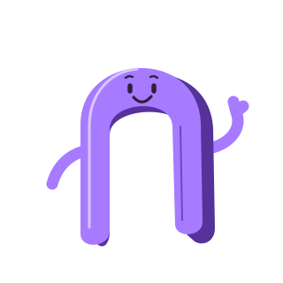
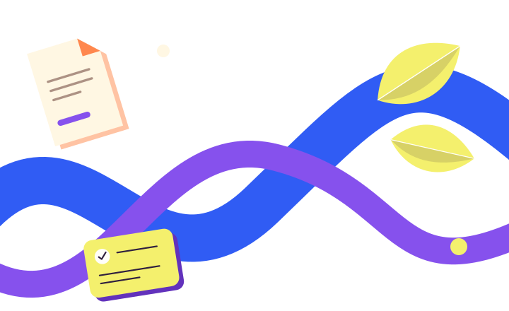

# Illustration and identity

[Handbook](../README.md) · [Character kit](../bend/README.md) · [Provenance](provenance.md)

## The visual world

Situate's illustrations are constructed from broad colored shapes with a small amount of hard-edged depth. They suggest folded paper and bent material, not glossy plastic, realistic clay, or a hand-drawn notebook. Use clean SVG paths, rounded caps, a few deliberate overlaps, and solid fills. The warmth comes from proportion, color, and subject matter—not texture noise or imitation paper scans.

Illustrate things someone might keep, consider, connect, or return to: pages, books, a small card, a folded leaf, a path through a collection. Avoid server racks, floating code windows, team org charts, robots, and anonymous business people as the default vocabulary.

## Wordmark

Use [wordmark.svg](../assets/wordmark.svg) on light grounds and [wordmark-light.svg](../assets/wordmark-light.svg) on ink. The original project-drawn wordmark has a `165 × 44` viewBox, rounded 5.7-unit strokes, and a tangerine dot. It is outlined artwork, not a redistributed font. Keep its proportions and dot intact.

- Standard header display: approximately 146 × 42 CSS px in a preserving-aspect-ratio SVG box. A compact header can use about 116 × 35 px; the footer can use about 105 × 30 px.
- Minimum display width: 100 CSS px. Leave clear space of at least half the displayed artwork height around it. Other controls can share the header but should not touch this space.
- Use ink lettering on paper/surface, or the supplied light lettering on ink. Do not rainbow-color the letters, add outlines, skew the geometry, or make the dot blink.
- Give a linked logo the accessible name “Situate” or “Situate, home,” according to its destination. Hide its child SVG from assistive technology when the link already has the name.
- If SVG cannot be used, plain text “Situate” remains understandable. It is a fallback, not an instruction to reconstruct the logo with a system font.

## Bend's identity

Bend is a tall, open violet arch with two grounded ends, a face near the crown, and narrow curved arms. The opening remains visibly open below the face. A darker offset body layer and a fine highlight create depth without a heavy outline. The expressive face includes eyebrows and a mouth, not just two dots.

Use [`bend/bend.js`](../bend/bend.js) as the geometry source. Its `320 × 320` viewBox is a construction frame; the silhouette deliberately does not fill every edge. Preserve that frame when placing it. Never trace a PNG or create a similar-looking replacement in a separate asset.

### Keep these features

| Keep                                             | Avoid                                                                     |
| ------------------------------------------------ | ------------------------------------------------------------------------- |
| Open arch and clear negative space               | A peach bridge across the opening or a closed ghost-like body             |
| Lavender front, deep violet side, thin highlight | Recoloring Bend to match each control or state                            |
| Small brows, eyes, and mouth near the crown      | Oversized eyes, a separate head, or moving the face down into the opening |
| Slim rounded arms attached to the body           | Detached hands, arms cutting visibly across the inner opening             |
| Two grounded lower ends                          | New feet, shoes, costumes, or a bouncing-ball body                        |
| Props as separate objects in front               | Reshaping the body into the object it holds                               |

The [construction diagram](../bend/anatomy.svg) shows the body's layer order and arm attachments. The kit's layer order, clipping, and attachment positions keep the opening clean and hands connected to props. Do not edit a generated SVG to repair a pose locally. Fix or extend the shared renderer and regenerate; see [implementation](implementation.md).

### Expressions and poses have different jobs

Expressions describe a small emotional inflection. Poses describe what Bend is doing. Choose both deliberately; neither is application state by itself.

| Situation                                        | Pose        | Expression             | Usage decision                                           |
| ------------------------------------------------ | ----------- | ---------------------- | -------------------------------------------------------- |
| A welcome                                        | `wave`      | `welcome`              | One greeting; then rest                                  |
| A quiet personal space                           | `rest`      | `welcome`              | Optional static presence, usually omit during dense work |
| Looking at a note or reading material            | `read`      | `thinking`             | Put the content, not the character, first                |
| Gathering a small collection                     | `carry`     | `welcome` or `pleased` | Show a user-directed assembly, not independent work      |
| A meaningful result the person chose to complete | `celebrate` | `pleased`              | One finite acknowledgment, no repeated reward            |
| Introducing an adjacent feature or source        | `point`     | `curious`              | Keep the pointed-at label visible and actionable         |
| Asking for missing information                   | `rest`      | `unsure`               | State the actual question in text; no guilt or distress  |

The [performance rig](../bend/PERFORMANCE.md) adds transient blinks, a wink, small mouth openings, articulated arms, and lower-end steps for finite welcome scenes. The crown, shoulder anchors, palette, open silhouette, and static baseline remain unchanged. These are motion channels, not new static character drawings. See the [introduction](../examples/first-hello/index.html) for their use in context.

All supported combinations are listed in the [kit manual](../bend/README.md). Available geometry is not a recommendation to use every combination. For serious errors, consequences, data loss, or security decisions, omit the character rather than acting out alarm.

### Placement and scale

- **32 px:** diagnostic comparison only, not a full-character use or a toolbar/status icon. Do not rely on the mouth or eyebrows to communicate meaning.
- **64 px:** minimum full-character use; a small supporting presence with words for any state or purpose.
- **96–160 px:** modest empty state or compact explanatory panel.
- **185–352 px:** expressive vignette or welcome, where the character has room to read.
- **320 px construction scale:** inspect new poses here before reducing them.

At a displayed canvas size of 160 CSS px or larger, keep at least another 16 CSS px of clear space around the SVG box beside text or controls. In a scene, objects may overlap the lower body as a held prop does, but never hide the face or close the open silhouette. Do not stretch x and y differently, mirror the whole figure to fake a new pose, or crop it into a circular avatar.

A dark ink ground is a brand stage, not a separate character species. The same lavender body and face geometry must remain recognizable on both paper and ink. Inspect both backgrounds at 32, 64, and 320 px; recognition at a small size is not proof that expressions remain distinguishable there.

## Mini Bend

[Mini Bend](../bend/mini/README.md) is the compact counterpart: an open arch with two small eyes, no arms, mouth, props, depth, highlight, or lower connector. It has its own source in [`bend/mini/mini.js`](../bend/mini/mini.js); do not obtain it by shrinking the full character.

- **SVG:** use at 16–32 CSS px, with 24 px as the default. The two eyes sit inside the arch in this optical symbol. This is a miniature-only construction, not a change to the full character's crown face.
- **ASCII:** five columns and three lines of ordinary 7-bit characters, set in a local monospace font. At 10 px type with a 10 px line height, the mark is about 30 × 30 px. Font metrics vary; do not compress it into a 16 px slot.
- **Color:** one high-contrast color, normally ink on paper/surface or surface on plum. Inline artwork inherits `currentColor`; violet-deep is an optional accent on light grounds. No multicolor fills, shadows, gradients, or fading strokes.
- **Placement:** leave at least 8 px from adjacent text. A mark is not a touch target or an accessible status by itself; retain normal control sizing and words for the action or state.
- **Motion:** the arch stays fixed. Only a small eye change and blink repeat during an actual pending operation; stop on success, failure, or cancellation. Outside loading, keep it still. See [loading motion](motion.md#compact-loading-feedback).

The [reference](../reference/index.html#mini-bend) shows both formats on paper and plum and a reversible loading simulation. Mini Bend supplements, rather than replaces, standard action icons or the Situate wordmark.

## Illustration building blocks

Use the [asset files](provenance.md#asset-manifest) as editable SVG source. Their small irregularities are intentional, but the rules below let new objects belong to the same world.

| Element     | Construction recipe                                                                                                         | Role                                                           |
| ----------- | --------------------------------------------------------------------------------------------------------------------------- | -------------------------------------------------------------- |
| Page        | Portrait proportion about 160:190; cream front, warm offset back layer, folded upper corner, 3–4 short rounded text strokes | A note or document without copying real content                |
| Closed book | Portrait cover around 160:190; 8–11-unit corner curve at that scale; dark offset edge, narrow spine, one large arch motif   | A distinct object in a personal collection                     |
| Open book   | Two cream page planes around a center seam; plum rear plane; sparse 2–3-unit text strokes; one tangerine bookmark           | Reading, considering, returning to material                    |
| Card        | Landscape proportion around 210:150; 12–17-unit corners; offset backing; one large check or short abstract lines            | A compact result or item, not a live control                   |
| Folded leaf | Tall lens-like shape; diagonal fold from base to tip; ink overlay around 15–16% on one half                                 | A paper-garden accent, not a botanical realism motif           |
| Ribbon      | Long cubic curves, one dominant stroke, a darker offset depth, one fine highlight                                           | Connection and movement across a scene                         |
| Burst       | Broad alternating points with a small layered center; one per scene                                                         | Rare welcome or achievement accent, never a notification badge |

### Personal organization objects

The [illustration catalogue](../reference/illustrations.html) brings the foundational page, book, open book, card and folded leaf together with objects for four personal contexts:

| Context          | Objects                                                                  |
| ---------------- | ------------------------------------------------------------------------ |
| Collect and keep | Collection folder, paper tray, tabbed dividers, archive box, note bundle |
| Find and connect | Search lens, bookmark clip, linked notes, folded map, tag pair           |
| Plan and make    | Desk calendar, day strip, pencil trail, modular pieces, milestone flag   |
| A personal world | Reading lamp, ribbon cup, landscape print, travel wallet, paper mobile   |

Each object is available separately from `assets/`; the catalogue links directly to its SVG source. Use one beside a heading or combine two or three with an existing page, book or ribbon. The lamp and mobile need more vertical room; maps and the day strip need more horizontal room. Scale proportionally and keep the whole viewBox visible.

Paper and plum previews show the same artwork, not separate theme variants. Inspect the intended size and background when composing a scene. These are illustrations rather than small action icons: use standard controls and visible labels for search, tags, dates and other actual actions. A calendar or travel object can describe someone's material without promising an application feature. Keep Bend separate and leave its face and open silhouette clear.

### Depth and detail

A page or book can have an offset backing of roughly 5–8 units at a 160-unit width. Keep the light direction consistent across a composition. Add one shadow plane, not several blurred shadows. Interior marks should be sparse enough to remain abstract; they do not pretend to contain real notes.

At a full-width scene scale, ribbon widths around 55–102 units create the characteristic broad paths. In a smaller vignette, use about 35–67 units. These are illustration coordinates, not CSS border widths. Limit a scene to two or three broad paths, with distinct crossings. A ribbon should pass behind Bend or an object convincingly, not cut through a face or hand.

Color separates layers. Avoid gradients, photorealistic lighting, grain overlays, glossy highlights, stock illustrations, and emoji as substitutes. Decorative object marks may be subtle; any mark that communicates real state must satisfy contrast and labeling requirements.

## Background elements

Browse the [illustration catalogue](../reference/illustrations.html) for the ribbon and the abstract background elements. Objects name a subject; backgrounds shape the space around it. A background should still work when the foreground object changes.

| Element                                                   | Placement                                                      |
| --------------------------------------------------------- | -------------------------------------------------------------- |
| [offset discs](../assets/background-offset-discs.svg)     | A rounded field behind an object or cropped at an outer corner |
| [scalloped edge](../assets/background-scalloped-edge.svg) | An edge treatment for an illustration stage                    |
| [folded corner](../assets/background-folded-corner.svg)   | A corner accent with directional depth                         |
| [stepped planes](../assets/background-stepped-planes.svg) | A layered base or side boundary                                |
| [wave field](../assets/background-wave-field.svg)         | A low horizon behind a small collection                        |
| [cutout window](../assets/background-cutout-window.svg)   | An open frame around, rather than across, an object            |
| [paper fan](../assets/background-paper-fan.svg)           | A compact spread at an outer edge                              |
| [pebble cluster](../assets/background-pebble-cluster.svg) | A loose counterweight to one larger object                     |
| [lens pair](../assets/background-lens-pair.svg)           | A directional accent with open surrounding space               |
| [dash rhythm](../assets/background-dash-rhythm.svg)       | A small rhythmic accent away from text                         |
| [petal rosette](../assets/background-petal-rosette.svg)   | A single rounded counterpoint, not a status badge              |
| [orbit arcs](../assets/background-orbit-arcs.svg)         | A partial surround with a clear opening                        |

### Choose a role before a shape

- **A field:** offset discs, stepped planes or a wave field can give an object a setting without a full landscape.
- **An edge:** a scalloped edge or folded corner can enter from one side of a bounded illustration stage. Keep the crop intentional and leave the opposite side quiet.
- **A partial frame:** the cutout window or orbit arcs can surround an object. Keep the opening legible and avoid enclosing a text block as if it were a control.
- **A counterweight:** the fan, pebble cluster, lens pair, dash rhythm or rosette can balance one larger object. Choose one accent, not a scattering of all five.

### Layering and restraint

Start with one background field and one foreground object. Add at most one smaller accent when the composition needs balance. Background shapes may extend beyond a stage with `overflow: hidden`; the source SVGs remain complete, transparent artwork. Scale uniformly. Crop a field at the stage boundary, not a foreground object's meaning or Bend's face.

Keep decoration in a separate, non-interactive layer behind the objects. In HTML, use `alt=""` for decorative images and keep that layer out of the focus order and pointer hit-testing. Put captions and controls outside the art; never reduce an entire content container's opacity to quiet its decoration.

Use the pale planes or fewer shapes for quiet compositions. Saturated accents belong at an edge or an occasional expressive stage, not behind editable text, tables or task rows. Avoid repeated wallpaper, confetti, or multiple competing frames. These shapes do not communicate progress, approval, success, errors or security. They stay still; adding them does not require animation.

The catalogue's placement examples reuse the source assets with different cropping and spacing. They are composition recipes, not additional SVG variants or app screens.

## Composition recipes

### Panoramic welcome

[Panorama source](../assets/panorama.svg) uses a `1440 × 500` frame. Place it on ink, and place Bend separately so the character remains generated by the kit. The source leaves central space for the figure.

Build the scene in this order:

1. Dark ground and one cobalt path with a sky highlight.
2. One violet crossing path, without covering the central face area.
3. Four to six page/book/leaf objects, rotated roughly 10–25 degrees in alternating directions.
4. One Bend, around 320–352 CSS px at a large desktop composition; adapt proportionally to the scene's displayed size.
5. A tangerine foreground path, a sparse lemon accent, and at most one burst.

Keep the headline and main action above the stage. If there is a greeting button within the scene, use an independent HTML control with a stable target, not text embedded into the moving SVG. On narrow layouts, give those controls a separate strip below the art rather than covering the character.

For environmental motion, use the four generated `panorama-back-*` and `panorama-front-*` layers in their named paint order: back ribbons, back objects, front ribbons, front objects. Move only ribbon layers; objects and Bend stay steady. All four share the full `1440 × 500` frame. `panorama.svg` is the canonical source and the complete static composition; see [generation](implementation.md#workflow-a-new-illustration).

### Reading garden

[Reading garden source](../assets/reading-garden.svg) uses a `720 × 440` frame with a clear central placement area. Use sky as the surrounding field. Place Bend in `read` / `thinking` near the middle at roughly 300–330 units of scene width. Keep the page to one side and folded leaves near an outer edge. Follow with a short heading and paragraph in an unrotated text block.

### Gathering a collection

[Gathering source](../assets/gathering.svg) also uses `720 × 440`. Put Bend in `carry` / `welcome` on the open left-center area; use the burst and paper objects on the right to balance the figure. A light lilac field keeps the violet figure distinct without requiring a new costume or outline.

### Quiet contextual accent

Use a single [book](../assets/book.svg), [page](../assets/page.svg), or [quiet ribbon](../assets/quiet-ribbon.svg) next to a context heading. Keep it outside the text column and below the heading's visual priority. Do not add Bend simply because space is available. A daily view should not look like a cropped welcome scene.

## New subjects

To illustrate a new situation, choose one meaningful object before choosing an emotion. For a personal growing notebook, for example, combine a page with one folded leaf; do not add an entire landscape of plants. For a trip collection, a card with two abstract route marks can join a page and one curve. These are construction examples, not claims of a travel or gardening feature.

Keep the shared palette, one offset depth plane, rounded small details, and clear negative space. If a new situation needs a new Bend pose, extend the renderer and its generation checks rather than drawing an independently evolving mascot. Record the new asset's concrete filename and origin in [provenance](provenance.md).

## Accessible artwork

Decorative art next to a sufficient heading gets an empty `alt` or `aria-hidden="true"`. Informative art gets a concise description of what matters, not a list of all colors and coordinates. “Bend gathers books into a reading list” is useful only when that relationship is not already described next to it.

Avoid duplicate narration from a caption, SVG title, and parent accessible label. Every inline SVG instance that uses titles, clip paths, masks, or symbols needs document-unique IDs. External SVG images have their own document scope; copying their markup inline removes that separation. See [implementation](implementation.md#svg-labels-and-unique-ids).
